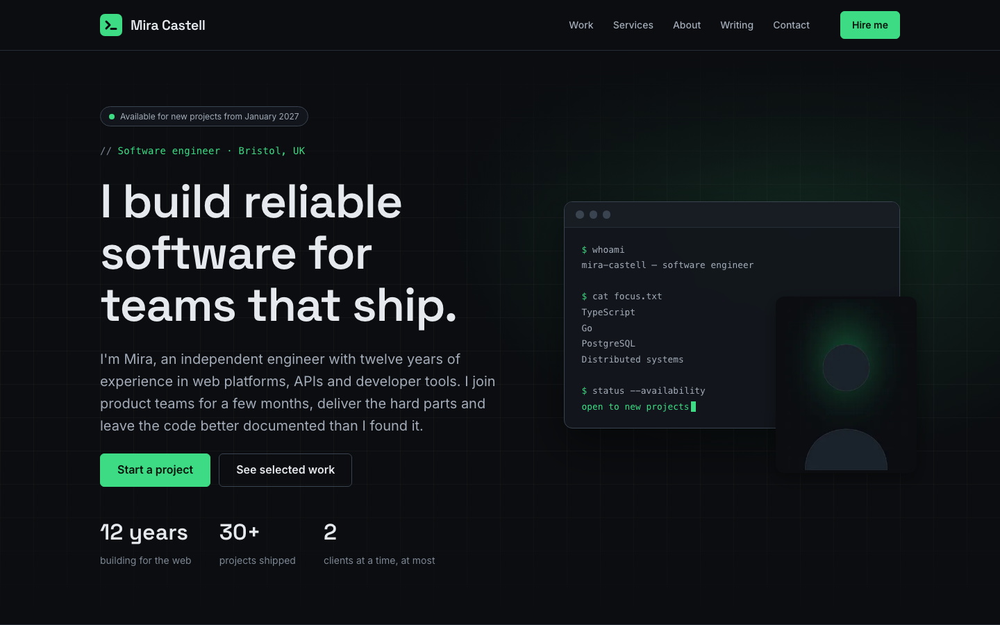

# Software Engineer Portfolio: a free Astro theme

[](LICENSE.md)
[](https://github.com/themesengine/software-engineer-portfolio-theme/actions/workflows/ci.yml)
[](https://astro.build)

A dark, technical, open source portfolio and landing-page theme by [ThemesEngine](https://themesengine.com) for independent software engineers, consultants and small dev studios. It covers case studies, services, writing and a project enquiry form that delivers to your inbox.



The demo brand, **Mira Castell**, is fictional. All client names, quotes and figures are demo content.

If this theme is useful to you, a ⭐ on GitHub helps other engineers find it.

## Features

- **Landing page** with an availability badge, terminal-style hero, selected work, services, principles, testimonials and latest articles
- **Case studies** (`/projects/<slug>`) with role, stack, outcomes, the challenge, approach and result, plus related projects
- **Services** (`/services/<slug>`) with what's included, process steps, FAQs and related case studies
- **About** page with bio, experience timeline, toolbox and working principles
- **Writing**: Markdown articles with categories, reading time, syntax-highlighted code and related articles
- **Project enquiry form** (`/hire`) and **contact form** (`/contact`) with the same validation in the browser and on the server, a honeypot, rate limiting and delivery by webhook and/or email (Resend)
- **SEO**: canonical URLs, Open Graph, `twitter:card`, `Person` JSON-LD with `jobTitle` and `knowsAbout`, `BlogPosting` and `BreadcrumbList`, generated `sitemap.xml` and `robots.txt`, one-switch noindex for staging
- **Fast and private**: static pages, optimised AVIF/WebP-ready images through `astro:assets`, self-hosted Google fonts (Space Grotesk and Inter), no trackers
- **Accessible**: skip link, keyboard-friendly mobile menu, visible focus, `aria-current`, labelled form errors, AA contrast on the dark palette, reduced-motion support
- **Production ready**: Node server with security headers, health check, Dockerfile, Compose file and CI workflow

## Requirements

- Node.js `^22.23.4`, `^24.16.0` or `>=26.3.0` (24 recommended, see `.nvmrc`)
- Yarn 1 (enabled through Corepack)

## Quick start

```sh
corepack enable
yarn install --frozen-lockfile
cp .env.example .env
yarn dev
```

Open http://localhost:4321.

## Scripts

| Command | What it does |
|---|---|
| `yarn dev` | Start the development server with hot reload |
| `yarn build` | Build the production site into `dist/` |
| `yarn start` | Serve the production build (`node server.mjs`) |
| `yarn lint` | Run ESLint |
| `yarn run check` | Lint and build. Use `yarn run check`, because `yarn check` is a built-in Yarn command |
| `yarn run package` | Create `dist/<name>-v<version>.zip` from the committed code |

## Environment variables

| Variable | When it's read | Purpose |
|---|---|---|
| `PUBLIC_SITE_URL` | Build | Public URL without a trailing slash. Used for canonical links, Open Graph, sitemap and robots |
| `PUBLIC_SITE_NOINDEX` | Build | `true` adds `noindex` to every page and blocks all crawling. Use it on staging |
| `HOST` | Runtime | Address `yarn start` listens on (default `localhost`) |
| `PORT` | Runtime | Port `yarn start` listens on (default `4321`) |
| `FORM_WEBHOOK_URL` | Runtime | Receives each form submission as JSON (Zapier, Make, n8n, Slack, your CRM) |
| `FORM_WEBHOOK_SECRET` | Runtime | Optional bearer token sent with webhook requests |
| `RESEND_API_KEY` | Runtime | Resend API key for email delivery |
| `FORM_EMAIL_TO` | Runtime | Comma-separated recipients |
| `FORM_EMAIL_FROM` | Runtime | Verified sender, e.g. `Your Name <web@your-domain.com>` |
| `DEMO_MODE` | Runtime | `true` accepts submissions without delivering them. Only for public demos |

Without a webhook or email transport, a production server answers form submissions with an error that shows your phone number and email, so enquiries are never silently lost.

## Where to edit things

| What | Where |
|---|---|
| Name, contact details, availability, social links, SEO defaults, footer theme credit | `src/data/site.js` |
| Menus, header button, footer columns, announcement bar | `src/data/navigation.js` |
| Bio, portrait, highlights, client names, experience, toolbox, principles | `src/data/profile.js` |
| Case studies | `src/data/projects.js` and `src/assets/images/projects/` |
| Services, prices, process and FAQs | `src/data/services.js` |
| Articles | `src/content/articles/*.md` and `src/assets/images/journal/` |
| Form options and validation | `src/lib/forms/enquiry.js`, `src/lib/forms/contact.js` |
| Colours, spacing, radii | `src/styles/tokens.css` |
| Fonts | `astro.config.mjs` (`fonts`) |
| Favicons, manifest, social image | `public/` |
| Privacy and terms | `src/pages/privacy.astro`, `src/pages/terms.astro` |

## Deployment

The pages are static, but the forms and `/api/health` run on the included Node server, so deploy it as a Node app or container. A plain static host only works if you point the forms at a form service yourself.

### Node

```sh
PUBLIC_SITE_URL=https://www.your-domain.com yarn build
HOST=0.0.0.0 PORT=3000 yarn start
```

### Docker

```sh
docker build --build-arg PUBLIC_SITE_URL=https://www.your-domain.com -t portfolio .
docker run -p 3000:3000 --env-file .env portfolio
```

### Docker Compose

```sh
cp .env.example .env   # fill in PUBLIC_SITE_URL and a form transport
docker compose up -d --build
```

See `documentation/index.html` for Render, Railway, DigitalOcean App Platform, Fly.io and VPS (Nginx or Caddy) guides.

## Project structure

```text
.
├── documentation/          index.html: full documentation
├── public/                 favicons, site.webmanifest, images/og-default.jpg
├── scripts/package.sh      builds the release zip
├── src/
│   ├── assets/images/      portrait, project covers, article images
│   ├── components/         Header, Footer, cards, forms, SEO, ...
│   ├── content/articles/   Markdown articles
│   ├── data/               site.js, navigation.js, profile.js, projects.js, services.js
│   ├── layouts/            Layout.astro
│   ├── lib/                articles, formatting, JSON-LD, forms, server delivery
│   ├── pages/              routes, api/, sitemap.xml, robots.txt, 404, 500
│   ├── scripts/            menu.js, enhanceForm.js
│   └── styles/             tokens, base, components/, pages/
├── astro.config.mjs        site, adapter, fonts
├── server.mjs              production server with security headers
├── Dockerfile, docker-compose.yml
└── README.md, CHANGELOG.md, LICENSE.md
```

## Contributing

Bug reports, fixes and improvements are welcome. See [CONTRIBUTING.md](CONTRIBUTING.md) to get started, and [SECURITY.md](SECURITY.md) to report a vulnerability privately.

## Support

Questions or problems? [Open an issue](https://github.com/themesengine/software-engineer-portfolio-theme/issues) with your theme version (see `CHANGELOG.md`) and the steps to reproduce the problem.

## Credits

| Item | License | Source |
|---|---|---|
| Astro | MIT | https://astro.build |
| @astrojs/node | MIT | https://github.com/withastro/astro |
| sharp (installed with Astro) | Apache-2.0 | https://sharp.pixelplumbing.com |
| ESLint, eslint-plugin-astro, globals | MIT | https://eslint.org |
| Space Grotesk (font) | SIL Open Font License 1.1 | https://fonts.google.com/specimen/Space+Grotesk |
| Inter (font) | SIL Open Font License 1.1 | https://fonts.google.com/specimen/Inter |

The project covers, article images, placeholder portrait, social image and favicons are original abstract artwork made for this theme and are covered by its MIT License. Replace the demo content, including `src/assets/images/portrait.jpg`, with your own before you publish.

## License

[MIT](LICENSE.md). Use it for personal or client sites, modify it and share it. The footer's "Theme by [ThemesEngine](https://themesengine.com)" credit is optional, but keeping it is a nice way to support the project. Set `showThemeCredit` to `false` in `src/data/site.js` to remove it.
